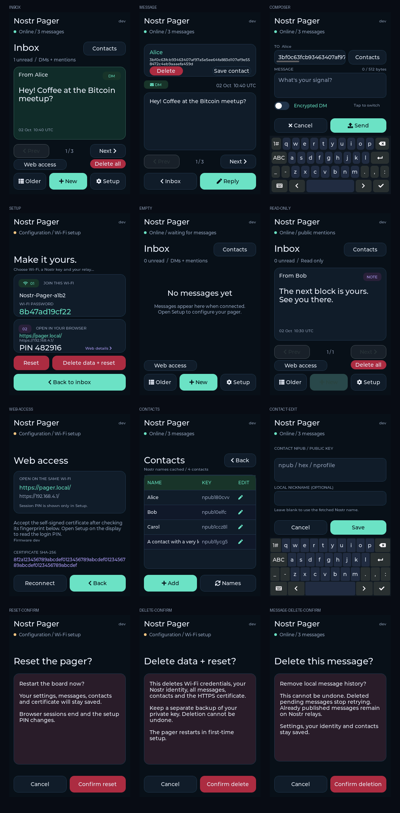

# Nostr Pager


A touchscreen Nostr pager for the **Guition JC3248W535C_I_Y**, built with PlatformIO, Arduino and LVGL. It uses a dark portrait interface, a captive portal for configuration, and an on-screen keyboard for messages.

The interface puts messages first, with a compact header, large previews, unread counts and privacy badges. Web access and contacts are one tap away.



These previews render the firmware's LVGL code with sample data. See [preview instructions](docs/development.md#render-the-interface-locally) to regenerate them.

## Features

- Wi-Fi setup with instructions and a large temporary network password on the display.
- HTTPS browser inbox, reader, replies and composition, unlocked with the display's six-digit PIN.
- Self-signed device certificates with fingerprint display, download and regeneration.
- mDNS browser access at `https://pager.local/`, with an IP fallback on the display.
- Nostr identity input as hex, `npub`, `nsec`, `nprofile`, or a `nostr:` link.
- Public mentions with a public key; modern encrypted DMs and legacy DM replies with a private key.
- Published DM inbox/general relay lists, recipient inbox discovery and relay authentication.
- Editable public and backup DM relay lists, connection/publication tables, failure backoff and a Reconnect action.
- Inbox, message reader, composer, unread count, and a brief visual notification.
- Persistent history for up to 60 messages and one pending outgoing message.
- Confirmed deletion of one message or all local history, with persistent suppression on relay refresh.
- Flash-backed address book for 24 contacts, signed Nostr profile names, local nicknames and display/web contact pickers.
- Verified TLS relay connections and incoming event IDs/signatures.

Private mode implements **two-person NIP-17 DMs** with NIP-44 v2/NIP-59 gift wrapping, publishes kind-10050 DM inbox lists and kind-10002 general relay lists, and supports NIP-42 relay authentication. Legacy NIP-04 messages remain readable and replies keep their legacy format. Group chats, attachments, sound and vibration are not implemented. Use a dedicated Nostr identity: credentials are stored in unencrypted device flash.

## Quick start

Run these commands from the project directory. A local `.venv` with PlatformIO is already available in the current workspace; on a fresh checkout, create it first:

```sh
python3 -m venv .venv
.venv/bin/pip install -r requirements.txt
.venv/bin/pio run
```

Connect the board with a data-capable USB cable, find its serial port, then upload:

```sh
.venv/bin/pio device list
.venv/bin/pio run -t upload --upload-port /dev/ttyACM0
.venv/bin/pio device monitor --port /dev/ttyACM0 --baud 115200
```

Replace `/dev/ttyACM0` with your actual port. No filesystem upload is required. See [setup and flashing](docs/setup.md) for recovery steps and fresh-machine requirements.

On first boot, join the `Nostr-Pager-xxxx` Wi-Fi network using the password shown on the display. Open **https://192.168.4.1/** in a full browser. Tap **Web details** on the display to compare the certificate fingerprint, accept the self-signed certificate, and enter the displayed six-digit PIN. Choose **Settings → Wi-Fi and Nostr setup**, enter your Wi-Fi credentials, Nostr key and `wss://` relay URL, then save. The HTTP captive page only explains how to reach HTTPS. The pager restarts and connects.

Tap a message to read it, **Reply** to answer, or **New** to compose. **Setup**, or holding BOOT for three seconds, reopens configuration. Tap **Web access** in the inbox for the HTTPS address; the PIN is shown only on the display's Setup screen. Setup has red **Reset** and **Delete data + reset** controls, each with a second confirmation. See [browser access](docs/web-interface.md) for login and reset controls.

## Documentation

| Guide | Contents |
| --- | --- |
| [Setup and flashing](docs/setup.md) | Virtual environment, compilation, upload, captive portal and configuration fields |
| [Using the pager](docs/user-guide.md) | Reading, composing, public/private modes, history and send status |
| [Hardware](docs/hardware.md) | Board definition, GPIO mapping, display/touch driver and flash layout |
| [Relay connections and recovery](docs/relays.md) | Multiple public relays, backup inboxes, tables, backoff and reconnect |
| [Architecture and protocol](docs/architecture.md) | Startup flow, relay subscriptions, cryptography and persistent data |
| [Development and validation](docs/development.md) | Source map, native tests, trust roots and hardware acceptance checks |
| [Browser interface](docs/web-interface.md) | HTTPS login, messaging, setup and certificate renewal |
| [Troubleshooting](docs/troubleshooting.md) | Build, upload, display, network, relay and storage problems |

## Firmware version

The display, browser pages, status API and serial log show the firmware version. Builds use a tag on the latest commit, or its short commit ID when untagged. A repository without commits uses `dev`. To set a release label explicitly:

```sh
NOSTR_PAGER_VERSION=v0.2.0 .venv/bin/pio run
```

Validation steps and limitations are in [Development and validation](docs/development.md).

GitHub Actions compiles the firmware on pushes, pull requests and manual runs. The downloadable artifact contains a `<version>_<board>` folder with the four flash images and `firmwares-nostr-pager.json` in the [DIYFlasher manifest format](https://github.com/valerio-vaccaro/diyflasher). Run `python3 scripts/package_firmware.py` after a local PlatformIO build to create the same `dist/` layout. DIYFlasher needs an entry for Nostr Pager before it can display this manifest.
