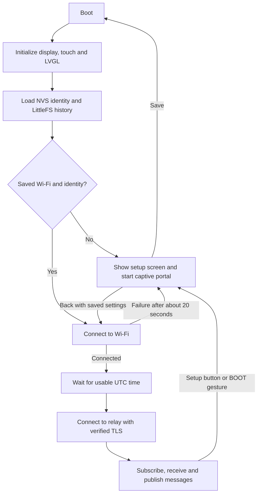

# Architecture and protocol

[Project README](../README.md) · [Development](development.md)

## Startup and runtime

The Arduino loop is pinned to core 1. It runs relay connections, portal instructions, deferred history saves, BOOT handling and LVGL. The ESP-IDF HTTPS task is pinned to core 0. It serves immutable cached snapshots and queues pager operations without waiting for the Arduino loop, so HTTP handlers do not access message/UI state concurrently. A failed display initialization stops startup and prints a serial error. Relay connection waits for time synchronization; there is no automatic NTP-timeout fallback.

LVGL compares the displayed message, contact label, cache position/count and unread state before rebuilding the inbox or reader. Connection status updates separately. Screen rebuilds preserve the scroll offset when the same message remains open; card taps resolve the displayed message ID rather than a vector position that a new arrival may have shifted. Theme transition animations and pressed-state growth are disabled in `include/lv_conf.h`. These changes reduce display work but do not move synchronous relay handshakes off the loop task.

## Captive portal

Configuration uses an ESP32 access point plus `DNSServer` and `WebServer`. DNS resolves names to the device; unknown HTTP routes redirect to `http://192.168.4.1/`. The HTTP page provides HTTPS connection instructions only. The authenticated HTTPS form submits to `/save`, validates input and stores configuration before scheduling a restart.

Each setup session has a random Wi-Fi password. HTTPS login requires the per-boot display PIN, then uses session cookies and CSRF tokens. Dynamic form values are HTML-escaped; pages use no-store and restrictive browser-policy headers. Setup adds an access point while preserving the saved Wi-Fi station connection and relay processing. Choosing Back closes the access point; saving configuration restarts the device.

## Browser HTTPS service

[src/web_pager.cpp](../src/web_pager.cpp) uses ESP-IDF 4.4's HTTPS server on port 443, pinned to core 0 with at most three client TLS sockets. A P-256 key and self-signed certificate are stored together in the `pager-tls` NVS namespace. The server starts when an AP or station network is available and remains available during setup. Startup logs the configured HTTPS affinity and actual pager worker core.

Core 1 publishes a complete immutable message/contact/relay/configuration snapshot approximately once per second, and after each browser mutation. [include/web_bridge.h](../include/web_bridge.h) exchanges shared pointers under a short mutex; JSON construction and rendering happen outside that lock. GET pages and the status API use the last published snapshot even while a relay handshake blocks core 1. The protected API returns `X-Pager-Snapshot-Age-Ms`; the inbox indicates cached data when it is over five seconds old. Wi-Fi, TLS hardware and RAM remain shared resources between cores.

Authenticated, CSRF-checked POSTs enqueue actions without waiting and redirect to a session-owned `/operations?id=...` status page. Pending operations return HTTP 202 with a one-second refresh and a Continue browsing link. On completion the page redirects to the destination, reports a validation/persistence error, or explains a restart. Up to four pending/completed operations are tracked; capacity pressure can replace completed results, and three-minute-old completed results are reclaimed on submission. Queued/running jobs never expire or disappear when a browser disconnects. A worker holds shared ownership through completion; release/acquire publication makes its result safe to read on core 0. A full queue returns 503 before submission, so the browser can retry without having queued an action. Reset and deletion still require their existing explicit confirmations.

Browser sessions and the global failed-login cooldown live only in the HTTP task. [include/web_auth.h](../include/web_auth.h) handles PIN validation, session lookup/expiry and constant-work token comparisons. A protected JSON snapshot provides message text and metadata to the browser; it omits signed event payloads and private configuration. The inbox polls every five seconds while visible; composer drafts are not refreshed. Forms call the same send/read/history/configuration functions as the display.

The browser shares one in-flight refresh promise and aborts a stalled request after ten seconds. A message card is replaced only when its data changes. Local expiry checks remove expired inbox entries and recompute unread counts without a network request. Browser refresh and relay delivery are independent: successful HTTPS navigation does not establish message delivery.

The **Generate new certificate** action writes a renewal flag and schedules a restart. Generation then replaces the saved identity, changes the certificate fingerprint and starts HTTPS. All RAM sessions are gone and a new boot PIN is generated. Browser assets in [assets/web](../assets/web/) are embedded by [scripts/embed_web.py](../scripts/embed_web.py); they require no external assets or network services.

## Relay subscriptions

The local [address book](contacts.md) stores canonical public keys, local aliases
and cached profile names in `/contacts.json`. Changes persist through a temporary
file followed by rename before the in-memory book is replaced. Kind-0 profiles
are requested per author on the existing relay connections with subscription ID
`contacts`; signatures, author keys and metadata freshness are checked before
names are cached. UI and authenticated web jobs share the contact model on the
Arduino loop task. Typed labels resolve only within this book and reject ambiguous
matches; contact pickers submit the canonical key directly.

The configured inbox `wss://` endpoint is connected through arduinoWebSockets with the embedded trust bundle. Failed primary connections back off from roughly eight seconds to 256 seconds, with jitter; a confirmed inbox subscription resets backoff. Heartbeat settings are 20-second ping, five-second pong timeout and two missed pongs. TLS handshakes are bounded to ten seconds.

[src/public_relays.cpp](../src/public_relays.cpp) owns one additional TLS socket, rotating public and backup/discovered DM inbox roles with per-endpoint failure backoff. A second auxiliary socket in the DM module handles discovery/publication or recipient delivery, independently of primary availability. This bounds the relay socket count to three. The rotation module requests public kind-1 mentions and, only on advertised DM inboxes in private mode, kind-4/1059 incoming events. All received messages pass the same production verification/decryption and cache-deduplication path. See [Relay connections](relays.md) for timing, history limits and publication behavior.

Public and private inboxes use separate persistent subscriptions, `pager` and `pager-dm`. A refusal of the private request therefore does not close public mentions. Each has its own status in Messaging connection. Legacy/public filters request up to 20 events each; the initial modern filter requests up to 200 envelopes within the last three days, because NIP-17 envelopes may be randomly backdated by up to two days:

| Identity | Filter |
| --- | --- |
| Both modes | Kind 1 with `#p` equal to the configured public key |
| Private mode | Kind 4 with `#p` equal to the configured public key |
| Private mode | Kind 1059 with `#p` equal to the configured public key |
| Private mode | Kind 4 with `authors` containing the configured public key |

The `older` and `older-dm` subscriptions use equivalent filters with an `until` timestamp preceding the oldest fetched timestamp, or a cached-history fallback. They close independently after `EOSE`. Older modern requests use the normal history-page limit and do not constrain `since`. Pagination is timestamp-based; a boundary with many equal timestamps can omit additional events at that exact second. Rotating relays similarly separate `public`/`dm-inbox` and `public-older`/`dm-older` requests and track both subscriptions.

Incoming `EVENT` frames must belong to a known subscription. Accepted events are deduplicated by ID and sorted by timestamp. The client handles `EOSE`, publication `OK`, `NOTICE`, `CLOSED`, and NIP-42 `AUTH` challenges. Authentication is signed with the configured identity; successful authentication retries subscriptions and publication.

[src/dm_relay.cpp](../src/dm_relay.cpp) fetches signed kind-10050/10002 records and publishes updated records to the primary when available and discovery endpoints `wss://relay.damus.io`, `wss://nos.lol` and `wss://purplepag.es`. Inbox metadata includes only the primary and up to six monitored backup/discovered endpoints; general metadata includes configured public endpoints. New private messages resolve the recipient's signed kind-10050 list through the configured/discovery relays. An auxiliary WebSocket connects to up to three advertised recipient endpoints sequentially; a publication acknowledgment from one completes delivery. Missing lists and unavailable relays leave the encrypted outbox pending for retry. No modern DM is published to an unlisted recipient endpoint. The sender's own encrypted copy is separately published to the configured inbox when available.

## Cryptography

[src/nostr_crypto.cpp](../src/nostr_crypto.cpp) builds the canonical array `[0, pubkey, created_at, kind, tags, content]` and hashes its compact JSON serialization with SHA-256. Incoming event IDs must match that hash and the BIP-340 signature must verify before a message is displayed or decrypted.

Kind-4 encryption uses the raw secp256k1 ECDH shared X coordinate as the AES-256 key, a random 16-byte IV, CBC mode and PKCS#7 padding. The content is base64 ciphertext followed by `?iv=` and a base64 IV. Decryption checks payload lengths and padding. Kind-1 content is publicly readable.

Modern text messages use unsigned kind-14 rumors, signed kind-13 seals and signed kind-1059 gift wraps. [src/nip44.cpp](../src/nip44.cpp) implements NIP-44 v2 conversation-key extraction, message-key expansion, authenticated padding and ChaCha20. The inner/outer layers use independent random nonces and new wrapper keys, with obscured wrapper/seal times. Decryption verifies both signatures, MACs, rumor ID, recipient and matching seal/rumor sender before exposing text. Signed seal and gift-wrap `expiration` tags are enforced; unknown signed tags are ignored. Group messages, attachments and inner JSON larger than 4096 bytes are rejected.

uBitcoin supplies curve operations and Schnorr signatures. The vendored copy includes local verification, compressed-point parsing and auxiliary-randomness fixes.

## Configuration and history

The Preferences namespace is `nostr-pager`. Its `config` value is a JSON string with `ssid`, `password`, `pubkey`, `secret`, `relay`, `publicRelays` and `dmRelays`. The last two are URL arrays. Missing arrays in older configuration use defaults; explicitly empty arrays disable configured extras. `fs-init` records successful filesystem initialization. The application formats LittleFS only if mounting fails and that marker has not yet been set.

`/history.jsonl` starts with an owner-bound `historyFilter: 1` record containing a `before` deletion cutoff and `deleted` ID/timestamp markers. Older files without that header remain readable. Following lines contain messages:

| Field | Contents |
| --- | --- |
| `owner` | Configured public key |
| `event` | Signed legacy/public event or modern gift wrap encrypted to this identity |
| `pending` | Recipient gift wrap awaiting acknowledgment; omitted for confirmed messages |
| `read` | Local read-state flag |
| `delivery` | Outgoing state such as pending, accepted or rejected |

Saves write `/history.tmp`, flush/close it and rename it over `/history.jsonl`. Records are revalidated on load and only the current owner's records are presented. DM ciphertext is persisted; decrypted text is held in RAM. Incoming changes normally save after two seconds, read-state changes after one second, and relay acknowledgment updates immediately. A failed save schedules a later retry.

[include/history_store.h](../include/history_store.h) stages single/all deletion against the live vector and filter, persists the complete replacement, and restores both on failure. Transport cancellation happens only after persistence succeeds. Receive/load suppress deleted IDs and messages at or before the cutoff. A new local send uses a timestamp after the deletion cutoff, so deletion and sending in the same second do not hide the new message. Individual markers are bounded at 128; a full marker set refuses another individual deletion rather than forgetting an old marker.

Sending creates and caches the outgoing encrypted event(s), persists them, then publishes. Modern messages keep their rumor ID for display/deduplication and a separate recipient wrapper ID for delivery acknowledgment. If persistence fails, publication is blocked and the new pending entry is removed. A restored pending event is republished after connection. Relay acknowledgment changes its state; acceptance does not establish recipient delivery or reading.

## Task model

Four FreeRTOS contexts keep slow network work away from the display and web pages:

| Task | Core / priority | Responsibility |
| --- | --- | --- |
| HTTPS server | 0 / 5 | Serves pages from immutable snapshots; never touches live state. |
| UI (`uiTask`) | 1 / 4 | LVGL rendering and touch. Takes the shared lock with a 40 ms timeout and skips the frame instead of waiting. |
| Web worker (Arduino `loop`) | 1 / 1 | Web jobs, snapshots, setup portal, history saving, Wi-Fi/AP calls (outside the lock). |
| Relay (`relayTask`) | 0 / 2 | Owns every WebSocket and relay module (primary, public, DM). Receives Nostr events, DMs and acknowledgements. |

`include/pager_sync.h` provides a recursive lock for shared state (messages, status, relay rows, contacts), held only for short sections. The relay task releases it around blocking calls (`socket.loop()`, `transport.loop()`, signature checks and decryption). Other tasks never call a socket or relay module directly: send, older-history, reconnect, relay-list save and delete post commands to the relay task with `pagerSync::post`.
